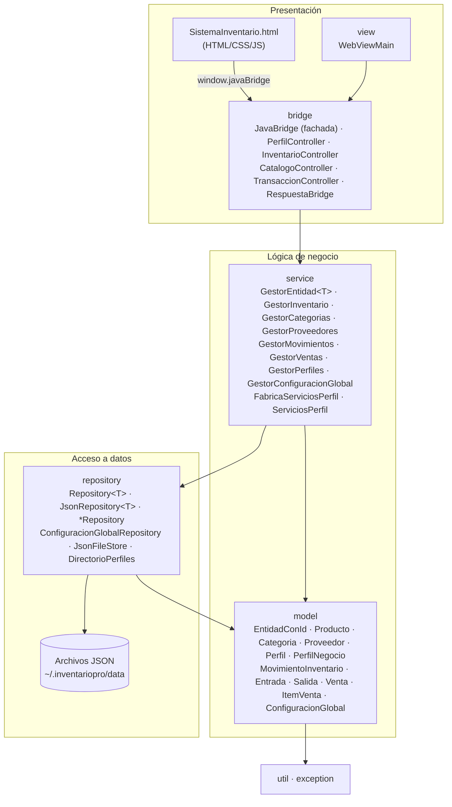

# Arquitectura — TBalance P3 (Avance 1)

## Capas y dependencias

La dependencia entre capas es siempre descendente: la vista conoce al bridge, el bridge a los servicios, los servicios a la **interfaz** de repositorio y al modelo. El modelo no depende de ninguna otra capa (solo de `util` y `exception`).

`AppContext` (Singleton) es la **raíz de composición**: crea los repositorios JSON concretos, los inyecta en los servicios y reemplaza los servicios del perfil activo cuando el usuario cambia de perfil.

## Responsabilidad de cada capa

| Capa | Responsabilidad | Cambios del avance P3 |
|---|---|---|
| `model` | Datos y reglas propias de cada entidad. | Las entidades pasan a ser **Expertas**: `Producto` controla su stock y vencimiento, `Venta` crea sus ítems y calcula su total. Nueva jerarquía `MovimientoInventario` → `Entrada`/`Salida`. |
| `repository` | Leer y escribir JSON. | Interfaz `Repository<T>`; `JsonFileStore` concentra la E/S con escritura segura; `DirectorioPerfiles` maneja carpetas. Errores como `PersistenciaException`. |
| `service` | Casos de uso. | `GestorEntidad<T>` (Template Method) elimina el CRUD duplicado; dependencias inyectadas por `FabricaServiciosPerfil`. |
| `bridge` | Traducir eventos de la vista a casos de uso. | `JavaBridge` (338 líneas en P2) se convierte en fachada que delega en 4 controladores; manejo de errores centralizado en `RespuestaBridge`. |
| `view` | Ventana JavaFX. | Solo construye la ventana y registra el bridge. `Launcher` permite ejecutar desde IntelliJ. |

## Persistencia (sin cambios de formato)

Se conservan los mismos archivos, nombres de atributos y ubicación que en P2, por lo que los datos existentes siguen funcionando. La única corrección automática es asignar ID a las categorías predefinidas que P2 guardaba con `"id": null`.
