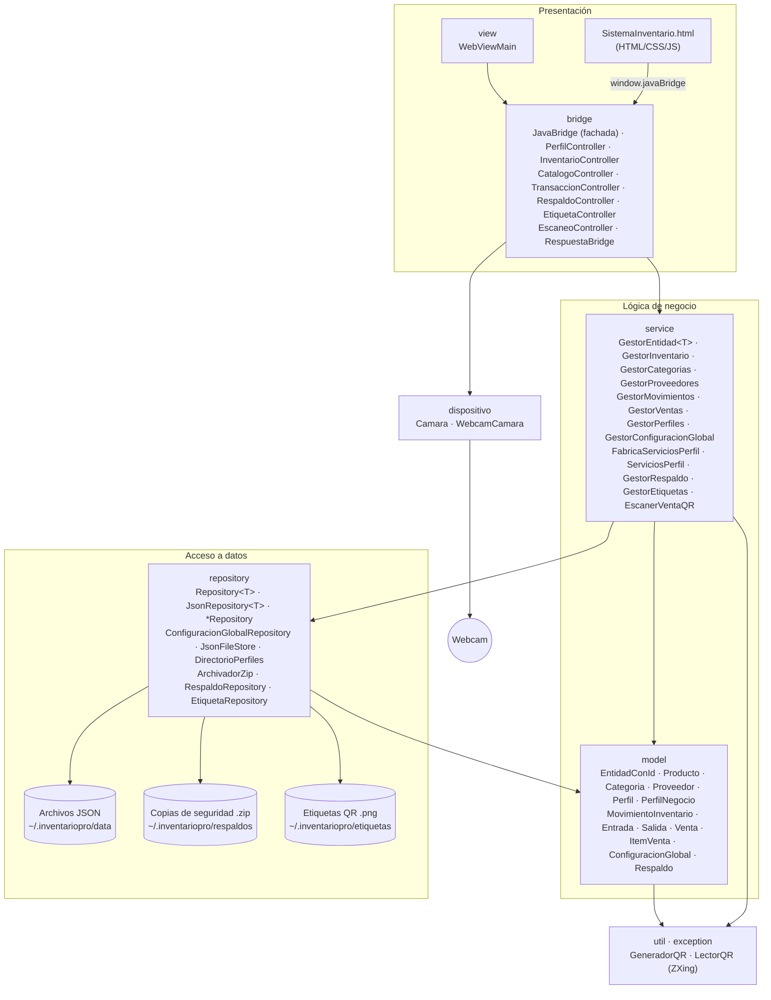
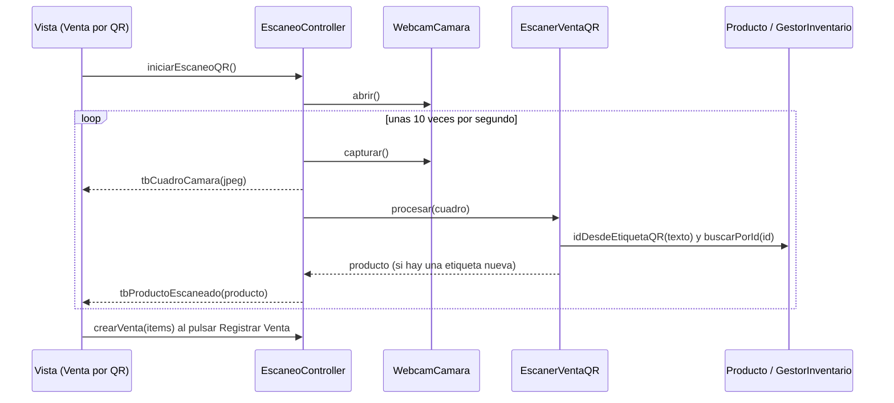

# Arquitectura — TBalance P3 (Avance 1)

## Capas y dependencias

La dependencia entre capas es siempre descendente: la vista conoce al bridge, el bridge a los servicios, los servicios a la **interfaz** de repositorio y al modelo. El modelo no depende de ninguna otra capa (solo de `util` y `exception`).

`AppContext` (Singleton) es la **raíz de composición**: crea los repositorios JSON concretos, los inyecta en los servicios y reemplaza los servicios del perfil activo cuando el usuario cambia de perfil.

## Responsabilidad de cada capa

| Capa | Responsabilidad | Cambios del avance P3 |
|---|---|---|
| `model` | Datos y reglas propias de cada entidad. | Las entidades pasan a ser **Expertas**: `Producto` controla su stock y vencimiento, `Venta` crea sus ítems y calcula su total. Nueva jerarquía `MovimientoInventario` → `Entrada`/`Salida`. |
| `repository` | Leer y escribir JSON. | Interfaz `Repository<T>`; `JsonFileStore` concentra la E/S con escritura segura; `DirectorioPerfiles` maneja carpetas. Errores como `PersistenciaException`. |
| `service` | Casos de uso. | `GestorEntidad<T>` (Template Method) elimina el CRUD duplicado; dependencias inyectadas por `FabricaServiciosPerfil`. |
| `bridge` | Traducir eventos de la vista a casos de uso. | `JavaBridge` (338 líneas en P2) se convierte en fachada que delega en 4 controladores; manejo de errores centralizado en `RespuestaBridge`. |
| `view` | Ventana JavaFX. | Solo construye la ventana y registra el bridge. `Launcher` permite ejecutar desde IntelliJ. |

## Copias de seguridad (versión 3.1.0)

| Capa | Clase | Responsabilidad |
|---|---|---|
| `repository` | `ArchivadorZip` | Comprimir la carpeta de datos en un `.zip` y extraerlo, rechazando rutas inseguras (*zip slip*). |
| `repository` | `RespaldoRepository` | Listar, ubicar y eliminar los archivos de `~/.inventariopro/respaldos`, validando los nombres recibidos. |
| `model` | `Respaldo` | Datos de solo lectura de una copia: nombre, fecha y tamaño. |
| `service` | `GestorRespaldo` | Crear, listar, restaurar (con copia automática previa) y eliminar copias. |
| raíz | `AppContext.recargar()` | Volver a leer todos los datos desde disco después de restaurar. |
| `bridge` | `RespaldoController` | Atender desde la vista las acciones de la sección **Respaldos**. |

## Venta por QR (versión 3.2.0)

| Capa | Clase | Responsabilidad |
|---|---|---|
| `util` | `GeneradorQR` | Convertir un texto en la imagen de un código QR (ZXing, corrección de errores L). |
| `util` | `LectorQR` | Leer el texto de un QR que aparece en un cuadro de la cámara (ZXing). |
| `util` | `CodificadorImagen` | Convertir un cuadro de la cámara en JPEG liviano para mostrarlo en la vista. |
| `model` | `Producto.contenidoEtiquetaQR()` / `idDesdeEtiquetaQR()` | El producto define el texto de su QR (`TBalance`, ID y precio) y sabe interpretarlo de vuelta. |
| `dispositivo` | `Camara` / `WebcamCamara` | Encender la webcam, entregar cuadros y apagarla; solo `WebcamCamara` conoce la librería *webcam-capture*. |
| `repository` | `EtiquetaRepository` | Guardar las etiquetas PNG en `~/.inventariopro/etiquetas`. |
| `service` | `GestorEtiquetas` | Dibujar la etiqueta (QR + nombre + precio) y armar hojas carta de 3 × 6. |
| `service` | `EscanerVentaQR` | Pasar de un cuadro de la cámara al producto, sin contar dos veces la misma etiqueta quieta. |
| `bridge` | `EtiquetaController` | Vista previa, guardar una etiqueta y generar la hoja de todos los productos. |
| `bridge` | `EscaneoController` | Encender y apagar la cámara en un hilo propio y avisar a la vista cada producto leído. |

## Persistencia (sin cambios de formato)

Se conservan los mismos archivos, nombres de atributos y ubicación que en P2, por lo que los datos existentes siguen funcionando. La única corrección automática es asignar ID a las categorías predefinidas que P2 guardaba con `"id": null`.
